# ultraweb

A [Claude Code](https://code.claude.com) plugin that builds websites through a guided design session: a short interview, mockups you pick from, a design system derived from the subject, the build, and quality gates that run in a real browser and return an exit code.

Version 2 is a rewrite. Version 1 shipped 80 skills and about 1.2 MB of instructions; it was slow, expensive and crowded the skill list of every session it was installed in. Version 2 has four skills and about a quarter of the text. It replaces the model-run checks with one script, and it moves the hard parts (colour maths, effects, choosing between options) out of prose into tested scripts and a kit of mountable building blocks, so that smaller models can follow it too.

## Status and evidence

Read this before installing.

- **Measured:** the gate scripts catch planted defects in CI (`tests/gates.test.mjs`, `tests/qa-scripts.test.mjs`), and the scaffold builds on the pinned stack (`scripts/scaffold-fixture.sh`, weekly).
- **Graded, small scale:** seven briefs were built by the smallest Claude model three ways: plain, with Anthropic's `frontend-design` skill, and with ultraweb (`evals/results/`). ultraweb's pages passed the measured gates on 14 of 15 homepages; the other two arms passed none of 13. On looks the grader preferred ultraweb's page twice across three rounds and the `frontend-design` page most of the time, at roughly 60% of ultraweb's tokens. One grader, one build per cell.
- **What that means:** ultraweb makes a small model's site correct, accessible and honest about what is drafted. It does not yet make it better looking than a short design skill does. For a one-page site, install `frontend-design` alongside; ultraweb's short path hands the visual design to it when it is present. That combination is untested.
- **Cost:** the only full-build receipt is from version 1: 6 h 06 min, 4,753 API calls and 756 million tokens processed for one site. Version 2 loads far less instruction text, but its cost has not been measured. Treat a standard build as a multi-hour job.
- **Award level:** the plugin aims at site-of-the-day quality and cannot promise it. Sites at that level depend on an original concept and on authored assets (photography, film, illustration, 3D). ultraweb supplies concept discipline, engineering and finish; the assets come from you or from generation tools in your session.

## Before and after

First screens from the comparison builds: same brief, same model (the smallest Claude tier), same prompt. Nothing here is cherry-picked in ultraweb's favour; the caption under each row says which page the grader preferred.

<table>
<tr><th>Plain</th><th>frontend-design</th><th>ultraweb</th></tr>
<tr>
<td>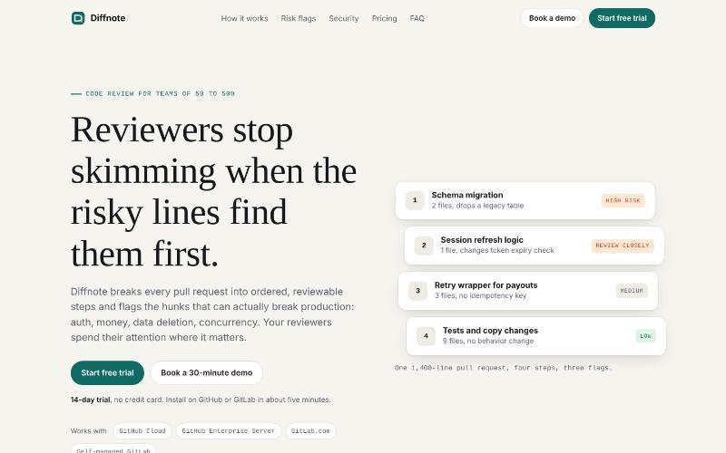</td>
<td>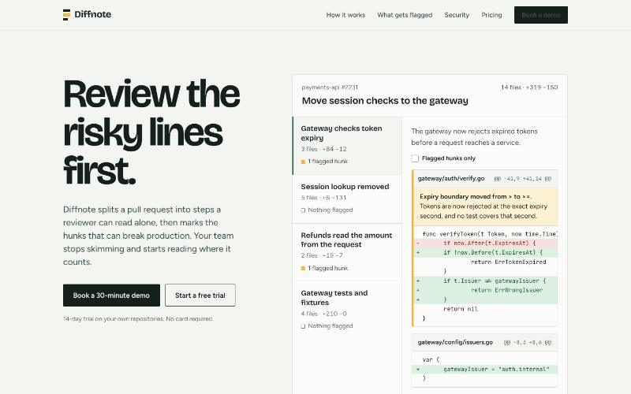</td>
<td>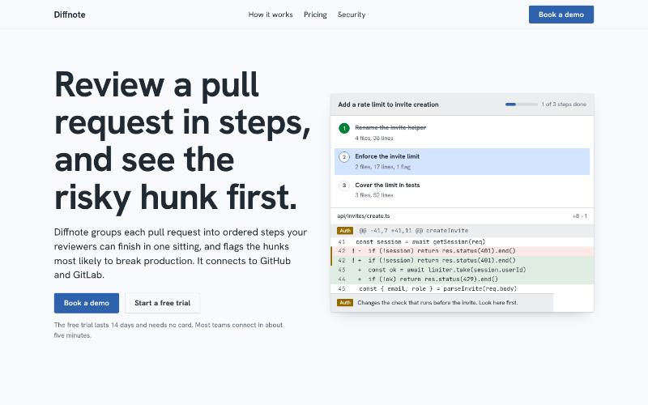</td>
</tr>
<tr><td colspan="3">Code review tool. Grader preferred <b>ultraweb</b>. Gates: ultraweb pass; plain failed 10 checks, frontend-design 7.</td></tr>
<tr>
<td>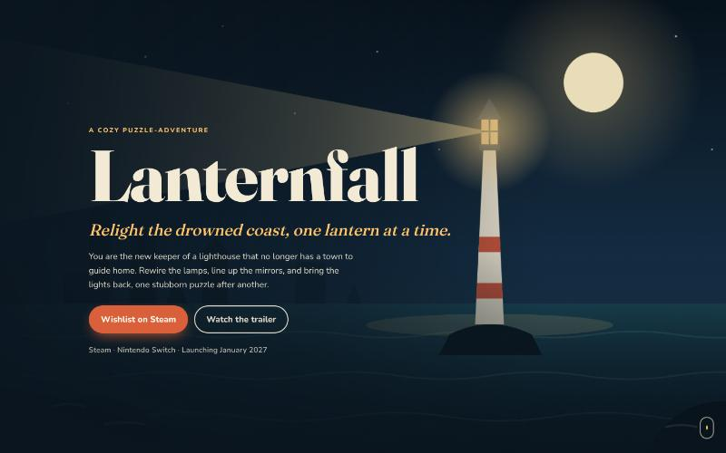</td>
<td>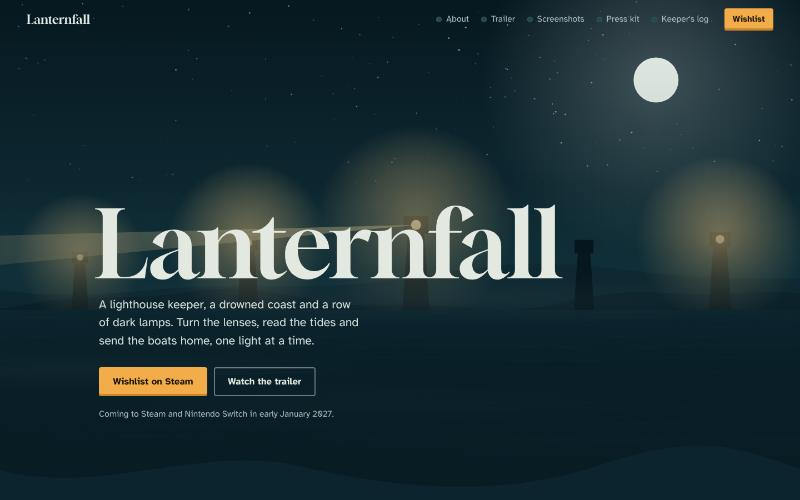</td>
<td>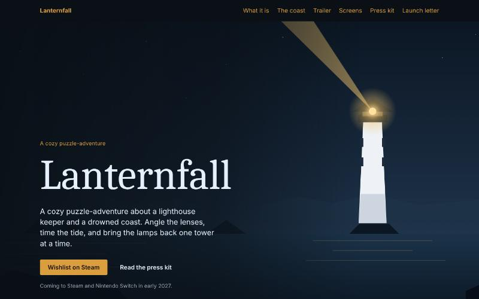</td>
</tr>
<tr><td colspan="3">Game launch. Grader preferred <b>ultraweb</b> in round 2 (frontend-design in round 1). Gates: ultraweb pass; plain failed 8, frontend-design 4.</td></tr>
<tr>
<td>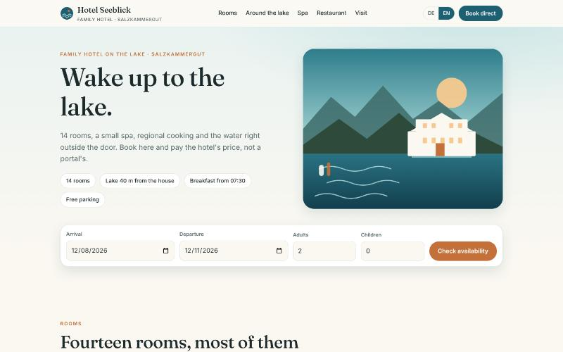</td>
<td>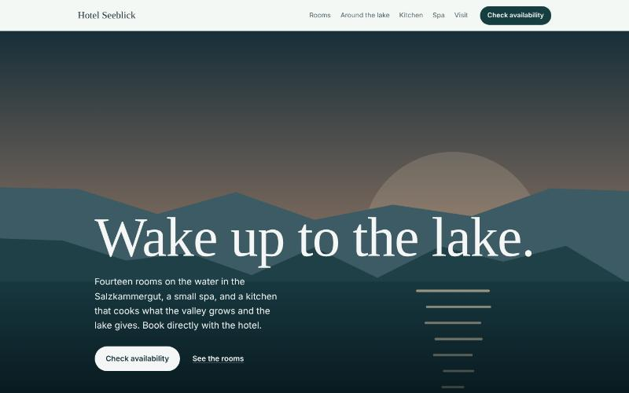</td>
<td>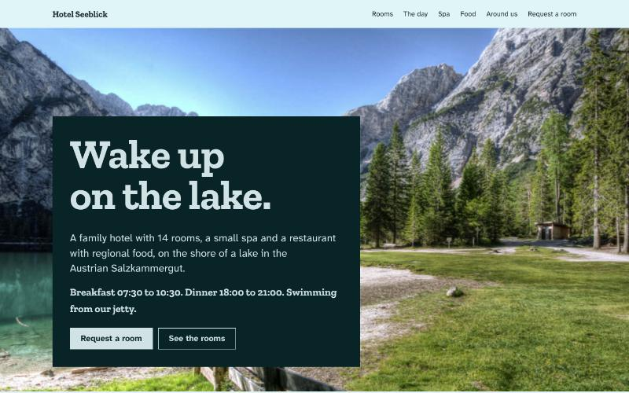</td>
</tr>
<tr><td colspan="3">Lake hotel. Grader preferred <b>frontend-design</b> in every round. Gates: ultraweb pass; plain failed 9, frontend-design 5. ultraweb's photographs are openly licensed stand-ins.</td></tr>
<tr>
<td>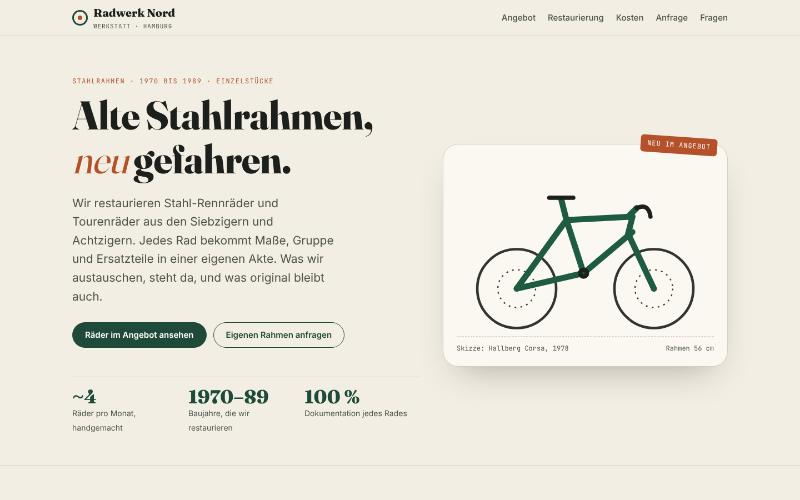</td>
<td>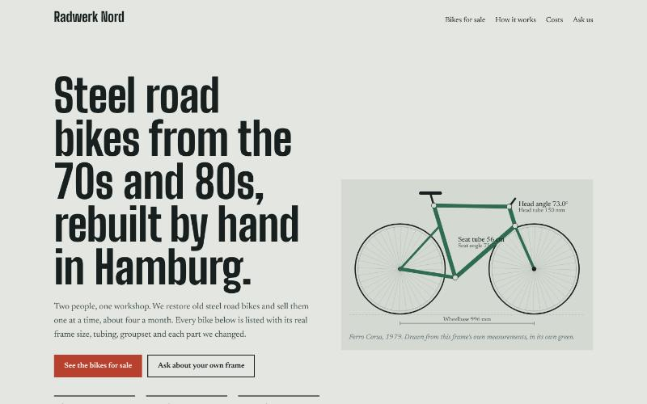</td>
<td>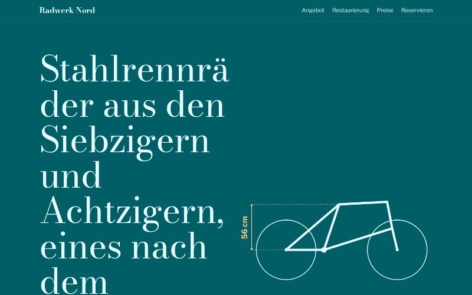</td>
</tr>
<tr><td colspan="3">Bike workshop. Grader preferred <b>frontend-design</b>. Gates: ultraweb pass; plain failed 10, frontend-design 7.</td></tr>
</table>

## Install

```text
/plugin marketplace add blyatiful1/ultraweb
/plugin install ultraweb@ultraweb
/reload-plugins
```

Requirements: Node 22 or newer, npm and git. The gates need Playwright with a Chromium browser; the scaffold adds it to the project, or install it yourself with `npm i -D playwright && npx playwright install chromium`. Without a browser the gates report UNVERIFIED and say so.

## Use

| You say | Skill | What happens |
|---|---|---|
| `/ultraweb build a site for a neighbourhood bakery with pre-orders` | `ultraweb` | The full guided build |
| "make the hero quieter", "add a pricing page" | `ultraweb:iterate` | A targeted change to a site ultraweb built; only the affected checks re-run |
| "audit the design of my site" | `ultraweb:retrofit` | A read-only audit of any site, written to `design/RETROFIT.md`; fixes only after you approve |
| "check this site" | `ultraweb:gates` | The deterministic checks against any running site or URL |
| "continue" | `ultraweb` | Resumes an interrupted build from `design/PROGRESS.md` |

**Modes.** `guided` (default) stops three times: you pick a mockup, you review the homepage, you accept the finished site. `autonomous` ("just build it") stops for nothing and logs every assumption.

**Tiers.** `sketch` is one static page, two mockups, one judge round. `standard` is a multi-page Next.js site. `flagship` adds a commissioned showpiece, requires real assets and gets up to four judge rounds against the award rubric.

## How it works

| Phase | What | Output |
|---|---|---|
| 0 | Preflight | capability report |
| 1 | Brief: up to four questions about scope and substance, never about aesthetics | `design/BRIEF.md` |
| 2 | Direction: the subject is studied first, then three candidates that must differ, one of them dealt by `scripts/deal.mjs`; you pick from rendered mockups | `design/DIRECTION.md` |
| 3 | System: colour, type, layout, form, imagery, motion as tokens | `design/SYSTEM.md`, token CSS |
| 4 | Structure and copy: copy is written before layout | `design/SITEMAP.md` |
| 5 | Scaffold and homepage, quick gates, one judge round; you review | homepage |
| 6 | Remaining pages; commerce, backend, legal and findability as the brief needs | all routes |
| 7 | Gates, then the judge | `qa/gates.json`, `qa/judge-round-N.md` |
| 8 | Acceptance, deploy, handoff | shipped site |

The instructions for each phase are plain files in `references/`, read one phase at a time. They are not skills, so they do not appear in your skill list.

### Taste without a house style

Version 1 banned the AI tells of 2023 and prescribed the ones of 2026. Version 2 does three things instead.

1. The look is derived from the subject: its materials, trade conventions, place and tension (`references/direction.md`). There is no archetype catalog and no font-pairing table.
2. Current default looks are named (`references/taste.md`) and counted by the gates' tells census. Each one needs a sentence in `design/DIRECTION.md` that derives it from the brief.
3. One of the three mockup candidates is dealt at random along eight axes and must be made to fit the brief, because options chosen by judgment cluster.

### A kit instead of instructions

A model does not have to be able to write a scroll-scrubbed sequence or a shader to use one. `kit/` holds effects ("moments") that are mounted with a few lines of documented markup: line-by-line type reveals, scroll-scrubbed text, a type marquee, pinned chapters, a horizontal rail, an image-sequence scrubber, photo reveals, a cursor trail, page transitions, shader grounds, a raymarched object and a particle field. Each one is dependency-free, reads the site's tokens, shows its content without JavaScript, stands still under reduced motion, cleans up after itself and is covered by `tests/kit.test.mjs`.

Scripts do the rest of what is easy to get wrong:

| Script | What it takes over |
|---|---|
| `scripts/palette.mjs` | colour tokens in OKLCH with every text and UI pair verified for contrast |
| `scripts/deal.mjs` | one mockup candidate dealt at random along eight axes, avoiding recent deals |
| `scripts/moments.mjs` | choosing kit moments that fit the site and its assets |
| `scripts/photos.mjs` | openly licensed stand-in photographs, with the credit each licence requires |
| `scripts/check-phase.mjs` | whether a phase's artifacts are complete before the build moves on |
| `scripts/gates.mjs` | the quality gates |

### Gates

```bash
node <plugin>/scripts/gates.mjs --url http://localhost:3100 --project .
```

One Node script drives a real browser over every route at three widths and checks code, content, accessibility, responsive behaviour, performance and default-look tells. It writes `qa/gates.json` and `qa/GATES.md` and exits 0 (PASS), 1 (FAIL) or 3 (UNVERIFIED). A Stop hook holds a build that tries to finish on a FAIL. Automated checks cover part of WCAG; a green run is not a conformance claim.

The visual critique runs in a separate context: the `design-judge` agent scores screenshots on the four jury axes (design 40, usability 30, creativity 20, content 10) and separately asks whether a stranger would take the site for a default generated one.

## Evaluating it

`evals/README.md` describes a blind comparison: the same six briefs built by plain Claude Code, by other design skills and by ultraweb, captured with `evals/capture.mjs` and graded pairwise in the page `evals/compare.mjs` builds, with cost per run. If you run it, please open an issue with the exported results, whichever way they point.

## Repository layout

```
SKILL.md                 the ultraweb skill (orchestrator)
skills/                  iterate, retrofit, gates
references/              per-phase instructions, loaded on demand
agents/design-judge.md   the fresh-context critic
kit/                     base stylesheet, auto-mounter, React wrapper and the moments
scripts/                 gates.mjs, measure/*, palette.mjs, deal.mjs, moments.mjs, photos.mjs, check-phase.mjs, site-check.mjs, verify-stack.mjs, lint-corpus.mjs
hooks/                   write-time placeholder check, gate Stop hook
stack/versions.json      the only place package versions are pinned
evals/                   briefs, capture and blind comparison
tests/                   node:test suites and fixtures
```

## Development

```bash
node scripts/lint-corpus.mjs      # skills, references, paths, size budgets
node --test tests/*.test.mjs      # needs playwright and axe-core resolvable
node scripts/verify-stack.mjs     # pins against the npm registry
```

## License

MIT. See [LICENSE](LICENSE).
